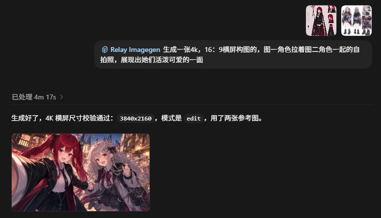

# Relay Imagegen

[中文说明](README.md)

Fixes the awkward parts of relay-based Codex image generation: unstable resolution, aspect ratio, prompt records, and output records.

Using a relay and still frustrated that Codex's in-chat image generation does not follow the aspect ratio? You ask for 16:9 and get 1:1; you ask for 4K and get a lower-resolution result. This Skill is built for that workflow.

Ultra quick setup:

Ask Codex:

```text
Codex, install this Skill for me: https://github.com/AwakeFantasy/relay-imagegen
```

Use it:

```text
$relay-imagegen Generate a 16:9 4K landscape image and show me the result
```

Example:



Why does this happen with in-chat image generation? The native conversational image flow is good at interpreting natural language, but Codex may not always convert "4K", "16:9", or "landscape" into stable low-level command parameters. Those requirements may only be placed in the prompt, which is not the same as passing `--size 3840x2160`. The result can be affected by default sizes, tool behavior, or model interpretation, producing lower-resolution, square, or mismatched-aspect images.

That is the short version. The detailed documentation starts below.

Relay Imagegen is a Codex Skill for generating and editing images through an OpenAI-compatible relay or proxy endpoint, with saved prompts and non-secret run metadata.

It is designed for relay-first image workflows that are easy to reuse and trace:

- Support for `gpt-image-2.5-flare`, `gpt-image-2.5-sunburst`, and `gpt-image-2`
- Dedicated local configuration for one or more relay URLs, API keys, and models
- Ordered failover across enabled relays for transport errors, HTTP 429, and 5xx responses
- Saved and reusable prompts via `prompts/*.txt`
- Non-secret `.meta.json` sidecar for each successful run
- Prompt snapshots saved into sidecar metadata
- Default size: `2560x1440`
- Default model: `gpt-image-2.5-flare`
- Default quality: `high`
- Default output directory: `generated/`
- Optional reference image downscaling before upload

## Use Cases

Use this Skill when:

- You generate images through a relay instead of the official OpenAI endpoint.
- You want to save prompts as reusable files.
- You want each run to preserve the prompt snapshot, model, size, inputs, output path, and elapsed time.
- You do not want a persistent system-level `OPENAI_API_KEY`.
- You edit images with local reference images.
- You want high-resolution defaults such as `2560x1440`.

## How It Works

Codex invokes the local Python image client. It:

1. Reads one or more relay settings from the Skill-root local config.
2. Calls the OpenAI-compatible Images API through the Python SDK.
3. Fails over in order only for transport errors, HTTP 429, or 5xx responses.
4. Verifies output dimensions and writes non-secret run metadata.

API keys are not printed, passed as command-line arguments, or written to run metadata.

## Requirements

- OpenAI-compatible relay with the Python SDK.
- Python 3.10+.
- An OpenAI-compatible image relay/proxy that supports your chosen image model.
- Optional: Pillow, for reference image preparation and output dimension checks.

## Installation

Clone or copy this repository into your Codex skills directory:

```powershell
git clone https://github.com/AwakeFantasy/relay-imagegen.git "$HOME/.codex/skills/relay-imagegen"
```

On Windows, the target directory is usually:

```text
C:\Users\<you>\.codex\skills\relay-imagegen
```

After installation, Codex can use the Skill when you mention relay image generation, saved prompts, run metadata, or `$relay-imagegen`.

## Quick Start

On first use, double-click `configure.pyw` or run the installed Skill setup script below to enter the relay URL, API key, and model. Codex calls the Python CLI directly afterward; the GUI is not opened for each image.

```powershell
$setup = "$HOME/.codex/skills/relay-imagegen/scripts/setup.py"
python $setup gui
```

Create a prompt file:

```text
prompts/test.txt
```

Dry-run first:

```powershell
$skill = "$HOME/.codex/skills/relay-imagegen/scripts/relay_imagegen.py"
python $skill generate --prompt-file prompts/test.txt --name test --dry-run
```

Generate:

```powershell
python $skill generate --prompt-file prompts/test.txt --name test --force
```

Default output:

```text
generated/test-YYYYMMDD-HHMMSS-2k.png
generated/test-YYYYMMDD-HHMMSS-2k.meta.json
```

## Configuration

Open `configure.pyw` from the Skill root, or run the setup command above. The GUI can add, remove, enable, disable, and reorder relay sources; later runs use them automatically without opening the GUI again.

The local config is stored at the Skill root and is ignored by Git. Manual editing is normally unnecessary.

The older single-source config remains compatible. The GUI writes a multi-source config roughly like this:

```json
{
  "sources": [
    {"name": "primary", "base_url": "https://relay-a.example/v1", "api_key": "...", "model": "gpt-image-2.5-flare"},
    {"name": "backup", "base_url": "https://relay-b.example/v1", "api_key": "...", "model": "gpt-image-2.5-sunburst"}
  ]
}
```

Failover is conservative: ordinary 4xx request errors stop immediately. A timeout can happen after a relay has accepted a request, so switching sources may create a duplicate request or charge. Successful sidecars record the selected source and non-secret failure summaries.

The local agent can run `python $skill --list-sources` to see configured source names and models, then choose one for the task with `--source <name>`. Flare suits fast everyday generation; prefer Sunburst when edit precision matters. Honor an explicit user model or source request.

Image streaming is optional. Add `--stream` to save partial previews beside the final image as `*.partial-N.<format>`; the final image keeps the requested output path. Set the preview count with `--partial-images 0..3` (default `1`). The relay must forward image SSE events. If a stream is interrupted, the server may already have completed the request, so the client will not automatically retry another source.

Never commit real config files.

## Generate Images

```powershell
$skill = "$HOME/.codex/skills/relay-imagegen/scripts/relay_imagegen.py"
python $skill generate `
  --prompt-file prompts/test.txt `
  --name test `
  --force
```

Default values:

```text
model   = gpt-image-2.5-flare
size    = 2560x1440
quality = high
output  = generated/
```

Inline prompt:

```powershell
python $skill generate `
  --prompt "A quiet cinematic room with warm soft lighting." `
  --name room `
  --force
```

Use `--prompt-file` for long prompts, Chinese prompts, or reusable prompts. Successful runs also save the prompt text into the `.meta.json` `prompt_snapshot` field.

## Edit with Reference Images

Single reference:

```powershell
python $skill edit `
  --image C:/path/to/reference.jpg `
  --prompt-file prompts/edit.txt `
  --name edit-test `
  --prepare-image `
  --force
```

Multiple references:

```powershell
python $skill edit `
  --image C:/path/to/composition.png `
  --image C:/path/to/character.jpg `
  --prompt-file prompts/edit.txt `
  --name final `
  --prepare-image `
  --force
```

This is useful when one reference provides composition or environment and another reference provides character identity or clothing.

## Reference Image Preparation

Use:

```powershell
--prepare-image
```

to downscale reference images to a max edge of `2048` pixels before upload.

Specify a different max edge:

```powershell
python $skill edit `
  --image C:/path/to/large-reference.jpg `
  --prompt-file prompts/edit.txt `
  --max-input-edge 1536 `
  --name prepared-edit `
  --force
```

By default, prepared upload copies are stored in a temporary directory and deleted after the run, so they do not clutter the current project.

If you want to keep them for debugging, add:

```powershell
--keep-prepared
```

Then copies are written under:

```text
generated/relay_prepared/
```

Original images are not modified.

## Output and Metadata

If `--out` is omitted:

```text
generated/<name>-YYYYMMDD-HHMMSS-2k.png
```

Example:

```text
generated/character-chair-20260527-183000-2k.png
```

A sidecar is written next to the image:

```text
generated/character-chair-20260527-183000-2k.meta.json
```

The sidecar includes non-secret metadata:

- mode
- model
- requested size and output dimensions
- quality
- prompt file
- prompt snapshot
- input reference paths
- prepared image dimensions; temporary prepared image paths are not kept by default
- selected relay, attempt order, and non-secret failure summaries
- elapsed seconds

It does not include API keys.

## Common Options

| Option | Description | Default |
| --- | --- | --- |
| `generate` / `edit` | Generate or edit mode | Required |
| `--prompt-file` | Read prompt from file | None |
| `--prompt` | Inline prompt | None |
| `--image` | Reference image for edit mode, repeatable | None |
| `--model` | Override the configured model | Model selected in config |
| `--source` | Prefer a configured source by name | First enabled source |
| `--list-sources` | List source names, models, and status without keys or URLs | Off |
| `--stream` | Save partial image previews locally | Off |
| `--partial-images` | Number of partial previews in streaming mode (0-3) | `1` |
| `--name` | Filename stem for auto output | Derived from mode or prompt file |
| `--out` | Exact output path | Auto-generated |
| `--output-dir` | Auto output directory | `generated` |
| `--size` | Output size | `2560x1440` |
| `--quality` | Output quality | `high` |
| `--timeout` | Timeout in seconds | `600` |
| `--prepare-image` | Downscale references before upload | Off |
| `--max-input-edge` | Reference max edge, also enables preparation | `2048` |
| `--keep-prepared` | Keep prepared upload copies under `generated/relay_prepared/` | Off |
| `--dry-run` | Print non-secret command shape only | Off |
| `--force` | Allow overwriting the output file | Off |

## Security Notes

- Do not pass API keys as command-line arguments.
- Do not commit real config files.
- You do not need to persist `OPENAI_API_KEY` in user or system environment variables.
- Keys are read only at runtime and never shown or saved in run metadata.
- Sidecar metadata never includes keys.

## Troubleshooting

### No Config Found

Open the local configuration GUI to set up or update the relay:

```powershell
$setup = "$HOME/.codex/skills/relay-imagegen/scripts/setup.py"
python $setup gui
```

### Output Size Is Not the Default Size

The default requested size is:

```text
2560x1440
```

If your relay or model does not support this size, the request may fail or the dimension check may reject the output.

### Request Takes Too Long

Increase timeout:

```powershell
python $skill generate --prompt-file prompts/test.txt --timeout 900 --name test --force
```

## Repository Layout

```text
relay-imagegen/
  README.md
  README_EN.md
  README/
  SKILL.md
  LICENSE
  agents/
    openai.yaml
  scripts/
    relay_imagegen.py
    setup.py
```

Not included in the public repository:

```text
config.json
generated/
*.meta.json
```

## License

[MIT License](LICENSE)
